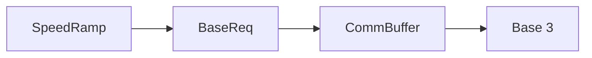

# Insertion Point

### Recommended location
In `src/pytrain/protocol/sequence/speed_ramp.py`, insert the send **inside `SpeedRamp.run()`, immediately after `self._acquire_claim()` and before the `while` loop** (around line 821):

```python
self._acquire_claim()
self._send_initial_target()  # New helper.
while self._is_running is True:
    # Existing ramp loop remains unchanged.
    ...
```

This places the target announcement after local ownership acquisition but before `_prime_deceleration()`, `_send_step()`, or `_settle()` can emit commands.

### Suggested helper
Add this method to `SpeedRamp`, keeping imports local like the existing send helpers:

```python
def _send_initial_target(self) -> None:
    from ...db.comp_data import encode_tmcc_speed
    from ...pdi.base_req import BaseReq

    # Read live state before taking the send gate.
    target = encode_tmcc_speed(self.target_speed, self.is_legacy)
    with self._wire:
        if self._is_running is False or self._claim_acquired is False:
            return
        BaseReq.update_target_speed(
            address=self.tmcc_id,
            speed=target,
            scope=self.scope,
        ).send(delay=0)
```

- `BaseReq.update_target_speed()` already exists at `src/pytrain/pdi/base_req.py:147`; it selects the engine or train command. Its serializer documents the firmware 1.38 target-speed behavior and handles two- and four-digit addressing.
- Use `self.target_speed`, the live-clamped destination, not the current speed or the unclamped request. `encode_tmcc_speed()` follows the existing database convention: Legacy values stay unchanged; TMCC1 values convert from 0–31 to the Base’s 0–199 scale.
- Check cancellation under `_wire`: `_acquire_claim()` catches ordinary acquisition failures and aborts rather than raising. An unconditional send immediately afterward would therefore be unsafe.
- `.send(delay=0)` uses the existing `PdiReq` → `CommBuffer` path, including forwarding through the server on clients. It submits the announcement first; it does not wait for a Base acknowledgment.



### Why not the other attached files?
- `RampSpeedReqBase._on_before_send()` is too early: ownership has not yet been acquired, and direct `EngineState.ramp_to()` callers bypass it.
- `RampPeer` should remain ownership-only. Its `publish_claim()` deliberately uses state-only transport that bypasses Base 3.
- `_send_step()` would announce repeatedly and miss the earlier deceleration commands.

**Scope:** This announces once per worker startup. `retarget()` reuses the worker without reentering `run()`, so subsequent targets—and mid-ramp ceiling changes—will not be announced by this hook. Keeping those synchronized would require a separate change-detection hook in the worker loop. Existing fallback absolute-speed requests remain unchanged.

# Validation

### Focused checks
Extend the existing recorder and fake-peer patterns in `tests/protocol/sequence/test_speed_ramp.py` and `tests/protocol/sequence/test_ramp_peer.py`:
- Verify claim acquisition → target announcement → first ramp command, including deceleration and already-at-target cases.
- Verify no target announcement after failed acquisition or cancellation before the send gate.
- Verify exactly one startup announcement, correct engine/train scope, live ceiling clamping, and TMCC1 encoding.
- Mock the PDI send in in-memory ramp tests so injected TMCC senders do not unexpectedly open real connections.

Reuse the packet coverage in `tests/pdi/test_base_req.py:434–505`; no new packet implementation is needed.

If implemented, verify the configured Python environment, run `../bin/python -m ruff format --check <changed Python files>` and correct any formatting failures, run every new or modified test and `../bin/python -m pytest`, and inspect every changed test file with PyCharm including warnings and weak warnings. Review American English usage, fix findings, and use only justified, narrowly scoped suppressions. Report unavailable verification. Hardware receipt and firmware behavior are not established by mocked tests.

No files have been modified and no tests have been run during this planning task.

# Delivery Steps

### ✓ Step 1: Add a guarded initial-target emitter to SpeedRamp
`SpeedRamp` can submit its effective destination using the existing Base 3 request.
- Add `_send_initial_target()` in `src/pytrain/protocol/sequence/speed_ramp.py`.
- Reuse `BaseReq.update_target_speed()` and `encode_tmcc_speed()` with the ramp’s address and scope.
- Snapshot the destination before taking `_wire`; suppress submission when canceled or ownership acquisition failed.
- Add mocked coverage for scope, speed encoding, ceiling clamping, and cancellation.

### ✓ Step 2: Announce the target before the ramp loop begins
Each newly started ramp submits one target announcement before its component commands.
- Call the helper immediately after `_acquire_claim()` in `SpeedRamp.run()`.
- Preserve existing stepping, retargeting, state-only claims, fallback requests, and teardown behavior.
- Extend recorder/fake-peer tests to verify ordering for acceleration, deceleration, and settling without a speed gap; isolate PDI sends in in-memory tests.
- Complete formatting checks, focused and full unit tests, PyCharm test-file inspections, and American English review as described in Validation.