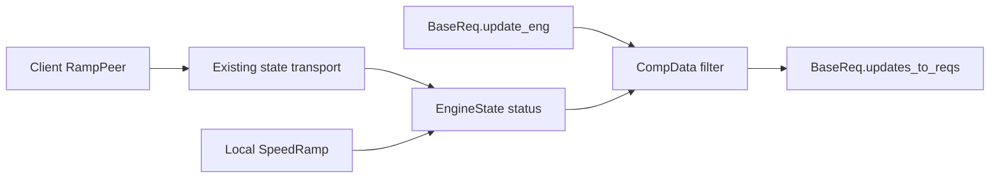

# Findings

### Server-visible status already exists
`state.is_ramping` is a local worker-maintained flag. A client-owned ramp intentionally leaves it false on the server. The server instead learns ownership through `publish_claim()` in `ramp_peer.py` and the existing state-update transport; `EngineState.ramp_claim` and `is_remote_ramping` expose that information.

Within the existing target-speed branch of `CompData._is_valid_update()`, the minimal fix using current properties is:
```python
return not (state.is_ramping or state.is_remote_ramping)
```

The planned convenience property also checks the local worker's `is_active` status, covering startup before the local flag is set. Retain the local flag in that property to preserve existing flag-based filtering.

### Intended behavior
- Suppress only `target_speed` packages derived from `ABSOLUTE_SPEED` when the same engine/train has local activity or a known remote claim.
- Continue actual-speed updates and normal target updates when no ramp is known. Activity on another address or scope must not affect this command.
- Preserve explicit ramp-target writes, existing remote-only throttle lockouts, and local retargeting.
- No new registry, transport, synchronization barrier, or shutdown behavior.

### Reliability boundary
Claims refresh every 5 seconds and expire after 15 seconds without refresh. `SpeedRamp` publishes before emitting steps, but server dispatch is asynchronous and there is no claim-processing acknowledgment. These checks therefore describe known activity, not a race-free, instantaneous system-wide guarantee. Startup delivery, delayed release, partitions, and nonparticipating controllers limit visibility; an absolute ordering guarantee would require a separate transport design.

`state.ramp` alone is insufficient because it can retain a finished object. `ramp.is_active` includes startup and worker lifetime, including custom-sender retargeting linger; the production peer-backed worker normally exits at settlement.

# Technical Design

### Existing path and cause
`BaseReq.update_eng()` in `src/pytrain/pdi/base_req.py` obtains packages from `CompData.request_to_updates()`. That calls `_filter_updates()` and `_is_valid_update()`, whose target-speed branch currently checks only `state.is_ramping`. `BaseReq.updates_to_reqs()` converts surviving target packages to memory writes and, for two-digit addresses, adds `UPDATE_ENGINE_SPEED` or `UPDATE_TRAIN_SPEED`. Filtering the package upstream prevents both writes without changing the converter.

Client claims travel through `CommBufferProxy.update_state()`, the `SENDING_STATE_REQUEST` handler in `enqueue_proxy_requests.py`, `CommBufferSingleton.update_state()`, and `CommandDispatcher` to the server state and other clients. `EngineState._update_ramp_claim()` handles ownership, refresh, and release. Reuse this existing flow; do not change module responsibilities or transport ordering.

### Status contract
Add the following read-only property, leaving `is_ramping`, its setter, and `is_remote_ramping` semantics intact:
```python
@property
def is_ramp_active(self) -> bool:
    ramp = self.ramp
    return self.is_ramping or (ramp is not None and ramp.is_active) or self.is_remote_ramping
```

The property is per engine/train, side-effect-free, and not an atomic distributed snapshot. The local flag preserves existing filtering, the captured worker reference covers startup, and the remote property uses existing claim expiration and ownership classification. An inactive retained handle alone returns false; a still-valid claim can keep the result true until release or expiration.

### Filtering boundary
Replace only the existing target-speed branch's status check with `return not state.is_ramp_active`. Preserve the `ABSOLUTE_SPEED` and `target_speed` conditions, scope/address lookup, map-copy behavior, other packages, and behavior when state is missing.

Do not add a blanket guard in `BaseReq.updates_to_reqs()` or `CompData.field_to_updates()`: `SpeedRamp._send_initial_target()` intentionally uses `BaseReq.update_target_speed()` and `do_update_field("RAMP_TARGET_SPEED", ...)` while active. Do not migrate GUI remote-only lockouts or other `is_ramping` consumers. Preserve existing emergency-stop alias behavior rather than redesigning it in this change.

### Affected files
- `src/pytrain/db/engine_state.py`: add the property and clarify local flag, worker, and remote ownership docstrings.
- `src/pytrain/db/comp_data.py`: use combined status in `_is_valid_update()` and clarify the command-derived filtering contract.
- `src/pytrain/protocol/sequence/speed_ramp.py`: document `is_active` lifecycle semantics only.
- `tests/db/test_ramp_claim_state.py`: extend real state/claim fixtures for combined status.
- `tests/db/test_comp_data.py`: extend command filtering tests; explicitly configure new status values on mocks to avoid truthy mock attributes.
- `tests/pdi/test_base_req.py`: extend `native_speed_state` and lifecycle regression patterns to cover remote claims and emitted request contents.

No production changes are needed in `base_req.py` or the transport files.

### Architecture diagram
The existing command conversion path consults the combined status; claim delivery is unchanged.


# Testing

### Status coverage
- With no local flag, active handle, or claim, combined status returns false; an inactive retained handle alone also returns false.
- A true local flag remains sufficient without a handle; an active local handle is sufficient before the flag is set or during custom-sender linger.
- A decoded remote claim makes combined status true while `is_ramping` stays false and `ramp` stays absent, matching server-side state.
- Matching release or expiration clears remote-only activity; refresh extends it, and a nonmatching release must not clear another owner.
- A matching local claim keeps `is_remote_ramping` false but combined status true. Reuse existing completion, abort, sender-failure, and local-retargeting tests as lifecycle regressions.

### Command-to-request coverage
- Extend `test_absolute_speed_commands_preserve_target_during_ramp` for local-flag, active-handle, remote-claim, inactive, and missing-state cases across engine/train scopes and TMCC/Legacy encodings.
- Extend the real-state `BaseReq.update_eng()` lifecycle pattern: claim arrival suppresses target writes even with no local worker; matching release or mocked-clock expiration restores them. Keep actual-speed writes and refresh markers throughout.
- Assert absence of both target memory writes at offset `0x08` and two-digit `UPDATE_ENGINE_SPEED`/`UPDATE_TRAIN_SPEED` injections; retain offset `0x07` actual-speed updates. Include a four-digit D4 case and address/scope isolation.
- Preserve explicit `field_to_updates()` and `RAMP_TARGET_SPEED` output while a claim is active, unrelated packages, existing emergency-stop alias behavior, and shared-map immutability.
- Use real claim requests and existing isolated fixtures with hardware/network sends mocked out. Use controlled state transitions, events, or a mocked clock rather than sleep-based assertions. These tests validate known-claim filtering, not a new network-ordering guarantee.

### Required verification during implementation
Consult the Python tooling instructions and confirm the configured interpreter before commands. Run every new or modified test, then `../bin/python -m pytest`. After Python edits, run `../bin/python -m ruff format --check <changed Python files>`; format and recheck if needed. Inspect every new or modified test file in PyCharm, including warnings and weak warnings, and review American English usage. Fix findings; use only justified, narrowly scoped inspection suppressions with specific IDs, then reinspect. Report any verification that cannot be completed.

Only the plan is being edited in this planning session; no source changes or test runs are performed.

# Delivery Steps

### ✓ Step 1: Expose combined local and remote ramp status
`EngineState.is_ramp_active` reports local flag/worker activity or known remote ownership for one engine/train.
- Implement the read-only property in `engine_state.py`, preserving existing local and remote status contracts.
- Clarify status docstrings there and `SpeedRamp.is_active` documentation, including startup, linger, claim freshness, and the lack of a distributed atomic guarantee.
- Extend `test_ramp_claim_state.py` for local flags/handles, decoded remote claims, release, refresh, expiration, and matching local ownership.
- Run the affected tests, format checks, PyCharm inspections, and American English review; reuse existing ramp lifecycle tests without changing lifecycle or shutdown code.

### ✓ Step 2: Preserve ramp targets during server command conversion
`ABSOLUTE_SPEED` conversion no longer overwrites a target while the same engine/train has known local or remote ramp activity.
- Switch the targeted branch in `CompData._is_valid_update()` to `is_ramp_active`; leave explicit field writes, actual speed, other packages, and missing-state behavior unchanged.
- Extend `test_comp_data.py` and `test_base_req.py` using existing mock and real-state fixtures, with explicit status attributes on mocks.
- Verify remote claim/release/expiration through `BaseReq.update_eng()`, both target-write forms, D4 requests, per-engine/train isolation, and explicit ramp-target writes.
- Complete targeted tests, the full unit suite, formatting checks, PyCharm inspections, and American English review as specified in the testing tab; report any unavailable verification.

### ✓ Step 3: Update / Follow-up
Several unit tests now fail. You should make a note to always run the tests and never complete a turn with broken tests. I am assuming the tests can be fixed without modifying the production code? If so, do so