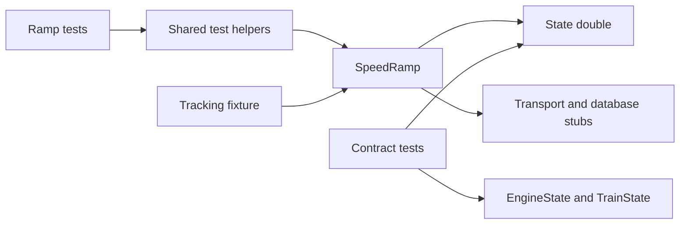

# Requirements

### Goals
- Repair the ramp test harness for the new `state.is_d4` check without removing or weakening production behavior.
- Cover both D4 and non-D4 startup paths while preserving target encoding, ownership, cancellation, and ordering assertions.
- Make shared ramp helpers easier to maintain and threaded failures easier to diagnose.

### Scope
Use the smaller **shared-double approach** as the proposed default: retain lightweight unit-test state, consolidate shared helpers, and add focused checks against real `EngineState`/`TrainState`. Keep existing real-state integration coverage.

Changes are limited to ramp tests and their support code. Do not redesign production interfaces, modify shutdown behavior, replace unrelated harnesses, loosen assertions, or add arbitrary sleeps.

### Acceptance Criteria
- Existing worker doubles expose an explicit boolean `is_d4`, defaulting to `False`.
- D4 startup skips the direct `BaseReq.update_target_speed()` call but still submits `RAMP_TARGET_SPEED`; non-D4 startup retains both operations.
- Shared helpers are no longer imported from collected test modules.
- Relevant worker tests isolate database-update submission, surface unexpected worker exceptions, and clean up owned workers with bounded waits.
- All new/modified tests pass, the full suite passes, and required formatting and PyCharm inspections are clean.

# Technical Design

### Findings
- `SpeedRamp._send_initial_target()` in `src/pytrain/protocol/sequence/speed_ramp.py` now reads `state.is_d4`. `RampEngineState` in `test_speed_ramp.py` inherits from `FakeEngineState` in `test_speed_ramp_geometry.py`; neither supplies that property.
- Production `EngineState.is_d4` requires both its D4 flag and a known record number. Address length alone does not establish D4 status.
- Worker helpers are imported by registry, echo, peer, and residual tests. `FakeEngineState.speed_max` also duplicates production ceiling logic.
- Sequence `conftest.py` already provides autospecced `pdi_send` and opt-in `ramp_target_update` fixtures. Registry, echo, and residual modules do not opt into the latter, although they reuse worker helpers.
- Registry teardown snapshots `active_ramps`, which can omit removed workers, and joins without checking termination.

### Immediate Repair
Extend the worker double's constructor with `is_d4: bool = False` and store that explicit effective property value. Do not infer it from `tmcc_id`, use permissive mocks, or add a production `getattr` fallback.

Extend the startup tests in `test_speed_ramp.py` and ordering coverage in `test_ramp_peer.py`:
- Non-D4: retain encoded direct-target submission and the unencoded database-field update.
- D4: assert the direct-target factory is never called, while the database-field update still occurs with `refresh=False`.
- Preserve the existing ownership/cancellation guards and claim-before-target-before-components ordering.

### Shared Helpers and Contract Checks
Move `FakeEngineState`, `RampEngineState`, `Recorder`, `build_ramp`, and `run_ramp` into a non-collected support module. Keep scenario-specific helpers local and import production constants from their defining module.

Add focused harness tests rather than reproducing all of `EngineState`:
- Compare represented D4 states with initialized real engine/train states, including D4 metadata with and without a record number.
- Compare duplicated ceiling resolution using equivalent decoded values for Legacy/TMCC1, unset limits, and competing limits.
- Run a synchronous startup/completion smoke test through the actual worker entry point, so missing consumed properties produce a direct traceback.
- Preserve intentionally synthetic geometry cases as explicit test-double behavior, not claimed production parity.

Use the transport-isolated real-state setup patterns from `test_ramp_peer.py::engine_states` and `tests/db/test_engine_state_core.py`; do not introduce more imports from test modules. Contract checks reduce drift but cannot guarantee compatibility with every future production change.

### Isolation and Worker Ownership
Enable `ramp_target_update` explicitly in the remaining worker-test modules; do not make it globally autouse or mock the startup method itself.

Add a function-scoped tracking fixture for threaded ramp tests. Track worker handles independently of registry membership, along with any gate-release callbacks. On teardown, attempt abort, release gates, and perform bounded joins for every tracked worker; report ordinary cleanup errors and surviving workers after attempting the remaining cleanup. Preserve genuine cancellation propagation and retain failed handles through any explicit retry. Production shutdown remains unchanged.

Promote unexpected `PytestUnhandledThreadExceptionWarning` to failures only in the affected ramp modules. Keep intentional exception tests synchronous and retain event-based synchronization.

### Files
All changes are under `tests/protocol/sequence/`:
- **Add:** `ramp_test_support.py` and `test_ramp_harness.py`.
- **Modify:** `conftest.py` for scoped lifecycle support.
- **Modify:** `test_speed_ramp.py`, `test_speed_ramp_geometry.py`, `test_ramp_registry.py`, `test_speed_ramp_echoes.py`, `test_ramp_peer.py`, and `test_ramp_residuals.py` for the repair, helper imports, and applicable isolation/lifecycle changes.

### Interaction

The real worker remains under test; only external effects are intercepted. Contract tests independently check the represented state behavior.

# Testing

### Coverage
- Engine and train scopes; D4 and non-D4 startup; Legacy/TMCC1 encoding where applicable; live target ceilings.
- D4 direct-send suppression without suppressing the database-field update or subsequent ramp commands.
- Claim acquisition, cancellation, startup ordering, and existing send-failure behavior.
- Real-state parity for D4 metadata and duplicated ceiling logic.
- Registry workers removed before teardown, gate release, bounded termination, and continued cleanup after an ordinary cleanup failure. Use controlled doubles for cleanup-failure cases rather than deliberately leaking threads.
- Existing ramp geometry, echo arbitration, registry, peer, and residual scenarios remain intact.

### Required Verification
During implementation, consult `python-tools` and confirm the configured interpreter before running toolchain commands.
1. Run every new/modified test and the affected ramp suites after each relevant change.
2. Run `../bin/python -m ruff format --check <changed Python files>`; if needed, format those files and rerun the check.
3. Inspect every new/modified test file in PyCharm, including warnings and weak warnings. Fix findings; use only justified, narrowly scoped inspection suppressions, then rerun inspections. Review names, comments, docstrings, and assertion messages for American English.
4. Run `../bin/python -m pytest` after the final changes. Do not declare implementation complete with known failures or without a passing full-suite run; report verification blockers explicitly.

### Planning Status
Static inspection confirms the missing-property defect. No recent IDE test results were available, so the reported 98 failures have not been individually classified. No project files were changed and no tests were run during planning.

# Delivery Steps

### ✓ Step 1: Repair the D4 state contract and startup regressions
The existing ramp harness supports the new D4 guard and explicitly verifies both startup branches.
- Add the default-false `is_d4` keyword to `RampEngineState` in `test_speed_ramp.py`.
- Extend startup and peer-ordering tests to verify D4 direct-send suppression and continued database-field submission.
- Preserve existing encoding, ownership, cancellation, and failure-path assertions.
- Run the affected tests, formatting checks, and PyCharm inspections for changed test files.

### ✓ Step 2: Consolidate shared ramp helpers and check state parity
Ramp tests use one dedicated support module with focused real-state compatibility coverage.
- Move shared state doubles, the recorder, and worker builders into `ramp_test_support.py`; update all six consuming test modules.
- Keep scenario-specific helpers local and remove cross-test imports of shared helpers and production constants.
- Add `test_ramp_harness.py` with D4 metadata, ceiling-resolution parity, and synchronous worker smoke tests.
- Validate geometry and worker behavior after the move, including formatting and PyCharm inspections.

### ✓ Step 3: Harden ramp isolation and worker cleanup
Threaded ramp tests own their workers explicitly and report failures without leaving cleanup dependent on registry membership.
- Extend explicit `ramp_target_update` fixture use to registry, echo, and residual worker tests.
- Add scoped worker tracking in `conftest.py`; register threaded workers and gate-release callbacks, attempt all cleanup, and verify bounded termination.
- Replace registry-snapshot-only cleanup and enable unexpected-thread-warning failures only in affected ramp modules.
- Add deterministic lifecycle checks without weakening assertions or changing production shutdown behavior.
- Run all new/modified tests, required formatting checks, PyCharm inspections including weak warnings, and the complete `../bin/python -m pytest` suite; report any blocker.